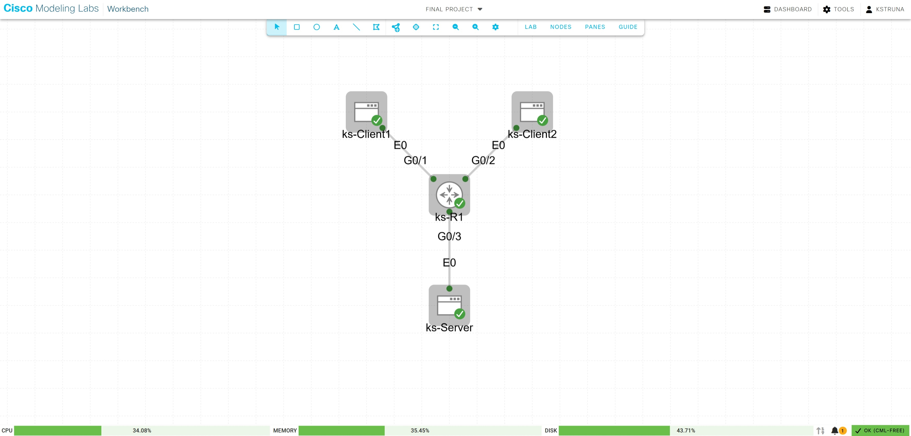

# CS 457 - Sprint 4 Network Verification Report

**Name:** Kevin Struna  
**Target Domain:** `server.struna.edu` (`192.168.20.100`)

---

## 1. Running CML Topology

Single-router CML topology with `ks-R1` connected to `ks-Client1` (Gi0/1), `ks-Client2` (Gi0/2), and `ks-Server` (Gi0/3).

---

## 2. Router CLI Verification (`ks-R1`)

### 2.1 `show ip interface brief`
~~~text
ks-R1>show ip interface brief
Interface                  IP-Address      OK? Method Status                Protocol
GigabitEthernet0/0         unassigned      YES unset  administratively down down    
GigabitEthernet0/1         192.168.10.1    YES TFTP   up                    up      
GigabitEthernet0/2         192.168.11.1    YES TFTP   up                    up      
GigabitEthernet0/3         192.168.20.1    YES TFTP   up                    up      
~~~

### 2.2 `show ip route`
~~~text
ks-R1>show ip route
Gateway of last resort is not set

      192.168.10.0/24 is variably subnetted, 2 subnets, 2 masks
C        192.168.10.0/24 is directly connected, GigabitEthernet0/1
L        192.168.10.1/32 is directly connected, GigabitEthernet0/1
      192.168.11.0/24 is variably subnetted, 2 subnets, 2 masks
C        192.168.11.0/24 is directly connected, GigabitEthernet0/2
L        192.168.11.1/32 is directly connected, GigabitEthernet0/2
      192.168.20.0/24 is variably subnetted, 2 subnets, 2 masks
C        192.168.20.0/24 is directly connected, GigabitEthernet0/3
L        192.168.20.1/32 is directly connected, GigabitEthernet0/3
~~~

### 2.3 `show ip dhcp binding`
~~~text
ks-R1>show ip dhcp binding
Bindings from all pools not associated with VRF:
IP address          Client-ID/              Lease expiration        Type
                    Hardware address/
                    User name
192.168.10.2        0152.5400.cd2b.2f       Nov 11 2026 10:12 PM    Automatic
192.168.11.2        0152.5400.7faf.65       Nov 11 2026 10:12 PM    Automatic
~~~

---

## 3. Game Server Static IP & Default Gateway (`ks-Server`)

~~~text
inserthostname-here:~$ sudo ip link set eth0 up && sudo ip route add default via 192.168.20.1 && ip addr show eth0 && ip route
2: eth0: <BROADCAST,MULTICAST,UP,LOWER_UP> mtu 1500 qdisc pfifo_fast state UP qlen 1000
    link/ether 52:54:00:09:98:88 brd ff:ff:ff:ff:ff:ff
    inet 192.168.20.100/24 scope global eth0
       valid_lft forever preferred_lft forever
    inet6 fe80::5054:ff:fe09:9888/64 scope link 
       valid_lft forever preferred_lft forever
default via 192.168.20.1 dev eth0 
192.168.20.0/24 dev eth0 scope link  src 192.168.20.100 
~~~

---

## 4. Client DHCP, DNS Resolution (`nslookup`), and `ping`

### 4.1 Client 1 (`ks-Client1` - `192.168.10.2`)
~~~text
inserthostname-here:~$ sudo ip link set eth0 up && sudo udhcpc -i eth0 && ip addr show eth0 && ip route && cat /etc/resolv.conf
udhcpc: started, v1.37.0
udhcpc: broadcasting discover
udhcpc: broadcasting select for 192.168.10.2, server 192.168.10.1
udhcpc: lease of 192.168.10.2 obtained from 192.168.10.1, lease time 86400
2: eth0: <BROADCAST,MULTICAST,UP,LOWER_UP> mtu 1500 qdisc pfifo_fast state UP qlen 1000
    link/ether 52:54:00:cd:2b:2f brd ff:ff:ff:ff:ff:ff
    inet 192.168.10.2/24 scope global eth0
       valid_lft forever preferred_lft forever
    inet6 fe80::5054:ff:fecd:2b2f/64 scope link 
       valid_lft forever preferred_lft forever
default via 192.168.10.1 dev eth0  metric 202 
192.168.10.0/24 dev eth0 scope link  src 192.168.10.2 
nameserver 192.168.10.1

inserthostname-here:~$ nslookup server.struna.edu
Server:         192.168.10.1
Address:        192.168.10.1:53

Non-authoritative answer:
Name:   server.struna.edu
Address: 192.168.20.100

*** Can't find server.struna.edu: No answer

inserthostname-here:~$ ping -c 4 192.168.20.100
PING 192.168.20.100 (192.168.20.100): 56 data bytes
64 bytes from 192.168.20.100: seq=0 ttl=42 time=11.417 ms
64 bytes from 192.168.20.100: seq=1 ttl=42 time=3.215 ms
64 bytes from 192.168.20.100: seq=2 ttl=42 time=3.204 ms
64 bytes from 192.168.20.100: seq=3 ttl=42 time=3.271 ms

--- 192.168.20.100 ping statistics ---
4 packets transmitted, 4 packets received, 0% packet loss
round-trip min/avg/max = 3.204/5.276/11.417 ms
~~~

### 4.2 Client 2 (`ks-Client2` - `192.168.11.2`)
~~~text
inserthostname-here:~$ sudo ip link set eth0 up && sudo udhcpc -i eth0 && ip addr show eth0 && ip route && cat /etc/resolv.conf
udhcpc: started, v1.37.0
udhcpc: broadcasting discover
udhcpc: broadcasting select for 192.168.11.2, server 192.168.11.1
udhcpc: lease of 192.168.11.2 obtained from 192.168.11.1, lease time 86400
2: eth0: <BROADCAST,MULTICAST,UP,LOWER_UP> mtu 1500 qdisc pfifo_fast state UP qlen 1000
    link/ether 52:54:00:7f:af:65 brd ff:ff:ff:ff:ff:ff
    inet 192.168.11.2/24 scope global eth0
       valid_lft forever preferred_lft forever
    inet6 fe80::5054:ff:fe7f:af65/64 scope link 
       valid_lft forever preferred_lft forever
default via 192.168.11.1 dev eth0  metric 202 
192.168.11.0/24 dev eth0 scope link  src 192.168.11.2 
nameserver 192.168.11.1

inserthostname-here:~$ nslookup server.struna.edu
Server:         192.168.11.1
Address:        192.168.11.1:53

Non-authoritative answer:
Name:   server.struna.edu
Address: 192.168.20.100

*** Can't find server.struna.edu: No answer

inserthostname-here:~$ ping -c 4 192.168.20.100
PING 192.168.20.100 (192.168.20.100): 56 data bytes
64 bytes from 192.168.20.100: seq=0 ttl=42 time=3.214 ms
64 bytes from 192.168.20.100: seq=1 ttl=42 time=3.410 ms
64 bytes from 192.168.20.100: seq=2 ttl=42 time=3.169 ms
64 bytes from 192.168.20.100: seq=3 ttl=42 time=3.622 ms

--- 192.168.20.100 ping statistics ---
4 packets transmitted, 4 packets received, 0% packet loss
round-trip min/avg/max = 3.169/3.353/3.622 ms
~~~

---

## 5. Wireshark DNS Packet Capture (`dns_lookup.pcap`)

- **Frame 6 (DNS Standard Query):** `192.168.10.2` -> `192.168.10.1` (UDP port 53) querying the `A` record for `server.struna.edu`.
- **Frame 8 (DNS Standard Response):** `192.168.10.1` -> `192.168.10.2` returning `192.168.20.100`.

