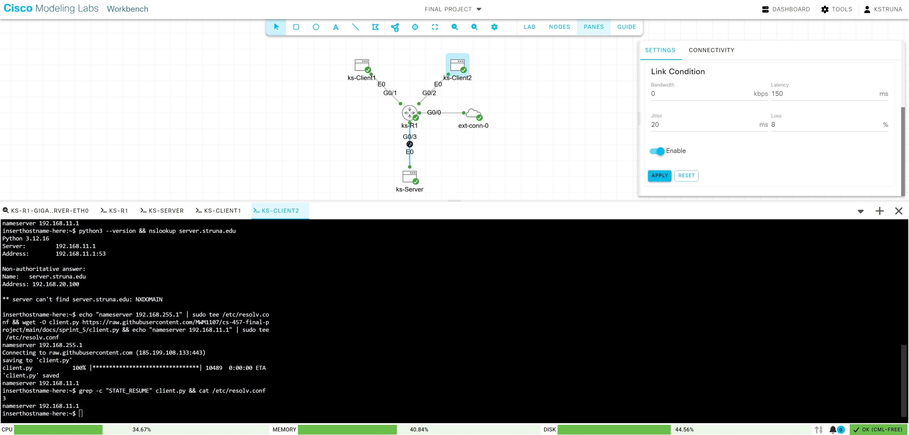

# CS 457 - Sprint 5: Impairment, Reconnection & Architectural Report

**Student Name:** Kevin Struna  
**Course:** CS 457 - Computer Networks  
**Target Server Domain:** `server.struna.edu` (`192.168.20.100`)  
**Walkthrough Video Link:** [sprint_5_video_walkthrough.mp4](./sprint_5_video_walkthrough.mp4)

---

## Part A: Impairment & Stateful Reconnection Testing

### 1. CML Link Condition Parameters
Applied link impairments on the `ks-R1 (Gi0/3) <-> ks-Server (eth0)` link (`192.168.20.0/24`):
- **Latency:** 150 ms
- **Jitter:** 20 ms
- **Packet Loss:** 8%

---

### 2. Wireshark Link Degradation Analysis (`sprint_5_degraded_network.pcap`)

#### 2.1 TCP Retransmissions (`tcp.analysis.retransmission`)
When `STATE_UPDATE` packets from the server (`192.168.20.100`) were dropped or their returning ACKs were lost across the 8% packet-loss link on `Gi0/3`, the server's Retransmission Timeout (RTO) expired and re-sent the unacknowledged TCP segments:
- **Frame 38:** `192.168.20.100 -> 192.168.11.2` (`[TCP Retransmission]`, `Seq=292`, `Len=178`).
- **Frame 39:** `192.168.20.100 -> 192.168.10.2` (`[TCP Retransmission]`, `Seq=360`, `Len=178`).
- **Frame 109:** `192.168.20.100 -> 192.168.10.2` (`[TCP Retransmission]`, `Seq=322`, `Len=218`).

#### 2.2 Duplicate Acknowledgments (`tcp.options.sack`)
Because Yahtzee is a turn-based protocol where each `MOVE` or `STATE_UPDATE` fits inside a single TCP segment (178–321 bytes), only one segment is in flight at a time. When a return ACK is dropped by the 8% link loss and the server retransmits the segment, the clients immediately reply with **Duplicate Selective Acknowledgments (D-SACK)** indicating the duplicate byte range (`SLE` = SACK Left Edge, `SRE` = SACK Right Edge) they already received:
- **Frame 40 (`192.168.11.2 -> 192.168.20.100`):** `Ack=470` with D-SACK `SLE=292 SRE=470` confirming duplicate receipt of Frame 38.
- **Frame 41 (`192.168.10.2 -> 192.168.20.100`):** `Ack=538` with D-SACK `SLE=360 SRE=538` confirming duplicate receipt of Frame 39.
- **Frame 110 (`192.168.10.2 -> 192.168.20.100`):** `Ack=540` with D-SACK `SLE=322 SRE=540` confirming duplicate receipt of Frame 109.

#### 2.3 TCP Timeouts, RTT Delay Analysis & Abrupt Disconnect/Reconnect Trace
Inspecting the packet timestamps across `sprint_5_degraded_network.pcap` shows both the ~150 ms–300 ms round-trip latency and the RTO backoff delays caused by the link conditioning:
- **RTO Timeout Delay (Frames 36 to 39):** Frame 36 (`Seq=360`) was initially sent at `14:56:04.373281` and retransmitted in Frame 39 at `14:56:05.541179`, demonstrating a **1.168-second RTO timeout**.
- **RTO Timeout Delay (Frames 107 to 109):** Frame 107 (`Seq=322`) was sent at `14:58:23.440179` and retransmitted in Frame 109 at `14:58:24.262545`, showing an **822 ms RTO timeout**.
- **Abrupt Disconnect & Stateful Reconnect (Frames 73 and 84–90):** Frame 73 (`14:57:07.530880`) captures the `[RST, ACK]` packet sent when `Kevin_S` (`192.168.10.2:51530`) pressed `Ctrl+C`. Frames 84–88 (`14:57:35.506085`) show `Kevin_S` reconnecting 28 seconds later on port `54708` (`[SYN]`, `[SYN, ACK]`, `[ACK]`) and receiving the 321-byte `STATE_RESUME` payload in Frame 90.

---

### 3. Stateful Reconnection Console Logs

#### 3.1 Server Console Output (`ks-Server` - `192.168.20.100`)
Demonstrates `server.py` accepting connections across subnets (`192.168.10.2` and `192.168.11.2`), catching `ConnectionResetError ([Errno 104])` when `Kevin_S` abruptly disconnects, transitioning to `TEMPORARILY_DISCONNECTED`, holding the scorecard in memory with a 60-second grace timer, and re-binding the session upon reconnection.

~~~text
inserthostname-here:~$ python3 server.py -p 8080
[FSM] State -> WAITING_FOR_PLAYERS
[SERVER] Yahtzee Server listening on 0.0.0.0:8080
[INFO] Player 'Kevin_S' connected from ('192.168.10.2', 51530).
[FSM] State -> LOBBY_WAIT
[INFO] Player 'Steven_S' connected from ('192.168.11.2', 34702).
[FSM] State -> GAME_START
[FSM] State -> PLAYER_TURN (Active: Kevin_S)
[FSM] State -> EVALUATE_MOVE (From: Kevin_S)
[FSM] State -> BROADCAST_STATE
[FSM] State -> PLAYER_TURN (Active: Kevin_S)
[FSM] State -> EVALUATE_MOVE (From: Kevin_S)
[FSM] State -> SCORE_UPDATE (Kevin_S scored 15 in chance)
[FSM] State -> CHECK_WIN_DRAW
[FSM] State -> PLAYER_TURN (Active: Steven_S)
[FSM] State -> EVALUATE_MOVE (From: Steven_S)
[FSM] State -> BROADCAST_STATE
[FSM] State -> PLAYER_TURN (Active: Steven_S)
[FSM] State -> EVALUATE_MOVE (From: Steven_S)
[FSM] State -> SCORE_UPDATE (Steven_S scored 0 in ones)
[FSM] State -> CHECK_WIN_DRAW
[FSM] State -> PLAYER_TURN (Active: Kevin_S)
[WARN] ConnectionResetError caught for 'Kevin_S': [Errno 104] Connection reset by peer
[FSM] State -> TEMPORARILY_DISCONNECTED ('Kevin_S' dropped)
[STATE PRESERVED] Holding game state & scores in memory. Starting 60s reconnect grace timer for 'Kevin_S'.
[RECONNECT] Player 'Kevin_S' reconnected from ('192.168.10.2', 54708)!
[RECONNECT] Re-binding socket and restoring preserved game state.
[FSM] State -> PLAYER_TURN (Active: Kevin_S)
[FSM] State -> EVALUATE_MOVE (From: Kevin_S)
[FSM] State -> SCORE_UPDATE (Kevin_S scored 3 in threes)
[FSM] State -> CHECK_WIN_DRAW
[FSM] State -> PLAYER_TURN (Active: Steven_S)
~~~

#### 3.2 Client 1 Console Output (`ks-Client1` - `192.168.10.2` Disconnect & Reconnect)
Demonstrates `Kevin_S` connecting via `server.struna.edu`, scoring `15` in `chance`, abruptly terminating via `Ctrl+C` (sending TCP RST), and re-running `client.py -i server.struna.edu -p 8080` with the `Kevin_S` alias to receive `STATE_RESUME` with all scores and dice (`[0]:6 [1]:1 [2]:3 [3]:6 [4]:4`) preserved.

~~~text
inserthostname-here:~$ python3 client.py -i server.struna.edu -p 8080
Enter your player alias (e.g., Kevin_S): Kevin_S
[CONNECTED] Connected to server.struna.edu (192.168.20.100:8080) as 'Kevin_S'.

[LOBBY] Waiting for opponent...

[GAME START] Match initiated! Roles: {'Kevin_S': 'Player_1', 'Steven_S': 'Player_2'}. First turn: Kevin_S

==========================================================
                 YAHTZEE SCOREBOARD
==========================================================
Category             | Kevin_S         | Steven_S       
----------------------------------------------------------
ones                 | -               | -              
twos                 | -               | -              
threes               | -               | -              
fours                | -               | -              
fives                | -               | -              
sixes                | -               | -              
three_of_a_kind      | -               | -              
four_of_a_kind       | -               | -              
full_house           | -               | -              
small_straight       | -               | -              
large_straight       | -               | -              
yahtzee              | -               | -              
chance               | -               | -              
----------------------------------------------------------
TOTAL SCORE          | 0               | 0              
==========================================================
Active Turn : Kevin_S
Current Dice: [0]:1  [1]:3  [2]:2  [3]:5  [4]:6   (Rolls Remaining: 2)

>>> YOUR TURN! Commands:
  hold <idx...>  - Hold dice at indices 0-4 & reroll rest (e.g., 'hold 0 2 4')
  roll           - Reroll all 5 dice
  score <cat>    - Score a category (e.g., 'score full_house' or 'score threes')
  quit           - Disconnect and forfeit
> hold 0 1

==========================================================
                 YAHTZEE SCOREBOARD
==========================================================
Category             | Kevin_S         | Steven_S       
----------------------------------------------------------
ones                 | -               | -              
twos                 | -               | -              
threes               | -               | -              
fours                | -               | -              
fives                | -               | -              
sixes                | -               | -              
three_of_a_kind      | -               | -              
four_of_a_kind       | -               | -              
full_house           | -               | -              
small_straight       | -               | -              
large_straight       | -               | -              
yahtzee              | -               | -              
chance               | -               | -              
----------------------------------------------------------
TOTAL SCORE          | 0               | 0              
==========================================================
Active Turn : Kevin_S
Current Dice: [0]:1  [1]:3  [2]:5  [3]:4  [4]:2   (Rolls Remaining: 1)

>>> YOUR TURN! Commands:
  hold <idx...>  - Hold dice at indices 0-4 & reroll rest (e.g., 'hold 0 2 4')
  roll           - Reroll all 5 dice
  score <cat>    - Score a category (e.g., 'score full_house' or 'score threes')
  quit           - Disconnect and forfeit
> score chance

==========================================================
                 YAHTZEE SCOREBOARD
==========================================================
Category             | Kevin_S         | Steven_S       
----------------------------------------------------------
ones                 | -               | -              
twos                 | -               | -              
threes               | -               | -              
fours                | -               | -              
fives                | -               | -              
sixes                | -               | -              
three_of_a_kind      | -               | -              
four_of_a_kind       | -               | -              
full_house           | -               | -              
small_straight       | -               | -              
large_straight       | -               | -              
yahtzee              | -               | -              
chance               | 15              | -              
----------------------------------------------------------
TOTAL SCORE          | 15              | 0              
==========================================================
Active Turn : Steven_S
Current Dice: [0]:5  [1]:6  [2]:3  [3]:6  [4]:5   (Rolls Remaining: 2)

--- Waiting for Steven_S to complete their turn... ---
> 
==========================================================
                 YAHTZEE SCOREBOARD
==========================================================
Category             | Kevin_S         | Steven_S       
----------------------------------------------------------
ones                 | -               | 0              
twos                 | -               | -              
threes               | -               | -              
fours                | -               | -              
fives                | -               | -              
sixes                | -               | -              
three_of_a_kind      | -               | -              
four_of_a_kind       | -               | -              
full_house           | -               | -              
small_straight       | -               | -              
large_straight       | -               | -              
yahtzee              | -               | -              
chance               | 15              | -              
----------------------------------------------------------
TOTAL SCORE          | 15              | 0              
==========================================================
Active Turn : Kevin_S
Current Dice: [0]:6  [1]:1  [2]:3  [3]:6  [4]:4   (Rolls Remaining: 2)

>>> YOUR TURN! Commands:
  hold <idx...>  - Hold dice at indices 0-4 & reroll rest (e.g., 'hold 0 2 4')
  roll           - Reroll all 5 dice
  score <cat>    - Score a category (e.g., 'score full_house' or 'score threes')
  quit           - Disconnect and forfeit
> ^C
[CLIENT] Simulating abrupt disconnect (TCP RST)...
inserthostname-here:~$ python3 client.py -i server.struna.edu -p 8080
Enter your player alias (e.g., Kevin_S): Kevin_S
[CONNECTED] Connected to server.struna.edu (192.168.20.100:8080) as 'Kevin_S'.

[STATE_RESUME] Session restored! Resuming match without state loss.

[STATUS] Player 'Kevin_S' reconnected! Game resumed without state loss.

==========================================================
                 YAHTZEE SCOREBOARD
==========================================================
Category             | Kevin_S         | Steven_S       
----------------------------------------------------------
ones                 | -               | 0              
twos                 | -               | -              
threes               | -               | -              
fours                | -               | -              
fives                | -               | -              
sixes                | -               | -              
three_of_a_kind      | -               | -              
four_of_a_kind       | -               | -              
full_house           | -               | -              
small_straight       | -               | -              
large_straight       | -               | -              
yahtzee              | -               | -              
chance               | 15              | -              
----------------------------------------------------------
TOTAL SCORE          | 15              | 0              
==========================================================
Active Turn : Kevin_S
Current Dice: [0]:6  [1]:1  [2]:3  [3]:6  [4]:4   (Rolls Remaining: 2)

>>> YOUR TURN! Commands:
  hold <idx...>  - Hold dice at indices 0-4 & reroll rest (e.g., 'hold 0 2 4')
  roll           - Reroll all 5 dice
  score <cat>    - Score a category (e.g., 'score full_house' or 'score threes')
  quit           - Disconnect and forfeit
> score threes

==========================================================
                 YAHTZEE SCOREBOARD
==========================================================
Category             | Kevin_S         | Steven_S       
----------------------------------------------------------
ones                 | -               | 0              
twos                 | -               | -              
threes               | 3               | -              
fours                | -               | -              
fives                | -               | -              
sixes                | -               | -              
three_of_a_kind      | -               | -              
four_of_a_kind       | -               | -              
full_house           | -               | -              
small_straight       | -               | -              
large_straight       | -               | -              
yahtzee              | -               | -              
chance               | 15              | -              
----------------------------------------------------------
TOTAL SCORE          | 18              | 0              
==========================================================
Active Turn : Steven_S
Current Dice: [0]:6  [1]:2  [2]:3  [3]:6  [4]:3   (Rolls Remaining: 2)

--- Waiting for Steven_S to complete their turn... ---
> 
~~~

#### 3.3 Client 2 Console Output (`ks-Client2` - `192.168.11.2` Notification & Resumption)
Demonstrates `Steven_S` receiving `[STATUS] Kevin_S disconnected. Waiting 60s for reconnect...` followed by `[STATE_RESUME] Session restored!` and the updated scoreboard after `Kevin_S` scores `threes`.

~~~text
inserthostname-here:~$ python3 client.py -i server.struna.edu -p 8080
Enter your player alias (e.g., Kevin_S): Steven_S
[CONNECTED] Connected to server.struna.edu (192.168.20.100:8080) as 'Steven_S'.

[GAME START] Match initiated! Roles: {'Kevin_S': 'Player_1', 'Steven_S': 'Player_2'}. First turn: Kevin_S

[STATUS] Kevin_S disconnected. Waiting 60s for reconnect...

==========================================================
                 YAHTZEE SCOREBOARD
==========================================================
Category             | Kevin_S         | Steven_S       
----------------------------------------------------------
ones                 | -               | 0              
twos                 | -               | -              
threes               | -               | -              
fours                | -               | -              
fives                | -               | -              
sixes                | -               | -              
three_of_a_kind      | -               | -              
four_of_a_kind       | -               | -              
full_house           | -               | -              
small_straight       | -               | -              
large_straight       | -               | -              
yahtzee              | -               | -              
chance               | 15              | -              
----------------------------------------------------------
TOTAL SCORE          | 15              | 0              
==========================================================
Active Turn : Kevin_S
Current Dice: [0]:6  [1]:1  [2]:3  [3]:6  [4]:4   (Rolls Remaining: 2)

--- Waiting for Kevin_S to complete their turn... ---
> 
[STATE_RESUME] Session restored! Resuming match without state loss.

[STATUS] Player 'Kevin_S' reconnected! Game resumed without state loss.

==========================================================
                 YAHTZEE SCOREBOARD
==========================================================
Category             | Kevin_S         | Steven_S       
----------------------------------------------------------
ones                 | -               | 0              
twos                 | -               | -              
threes               | 3               | -              
fours                | -               | -              
fives                | -               | -              
sixes                | -               | -              
three_of_a_kind      | -               | -              
four_of_a_kind       | -               | -              
full_house           | -               | -              
small_straight       | -               | -              
large_straight       | -               | -              
yahtzee              | -               | -              
chance               | 15              | -              
----------------------------------------------------------
TOTAL SCORE          | 18              | 0              
==========================================================
Active Turn : Steven_S
Current Dice: [0]:6  [1]:2  [2]:3  [3]:6  [4]:3   (Rolls Remaining: 2)

>>> YOUR TURN! Commands:
  hold <idx...>  - Hold dice at indices 0-4 & reroll rest (e.g., 'hold 0 2 4')
  roll           - Reroll all 5 dice
  score <cat>    - Score a category (e.g., 'score full_house' or 'score threes')
  quit           - Disconnect and forfeit
> 
~~~

---

## Part B: Architectural Choices & Project Retrospective

### 1. Architectural Model Selection (Threads vs. Selectors)
For the Yahtzee server, I chose a **multi-threaded architecture (`threading.Thread`)** over non-blocking I/O multiplexing (`selectors`).

- **Technical Rationale:** A two-player turn-based game only requires two concurrent client sockets. Spawning one daemon worker thread per client (`handle_client`) allowed me to write sequential socket reading loops (`recv_exact` and `recv_msg`) without manually tracking partial read buffers across state callbacks in an event loop.
- **Trade-offs & Synchronization:**
  - *Resource Overhead & Context Switching:* Threads carry more memory overhead and OS context-switching cost than a single-threaded `selectors` loop, which would matter if the server scaled to thousands of players. For a 2-player console game inside CML, the thread overhead is negligible.
  - *Synchronization Primitives & State Isolation:* Because worker threads share the server's memory space (`scorecards`, `current_dice`, `active_turn`, `client_sockets`), I used a single mutex lock (`self.game_state_lock = threading.Lock()`) around all state mutations and broadcasts. This prevented race conditions when validating turns or handling an abrupt client drop while a move was being processed.

---

### 2. Library Choices & Rationale

| Library | Why It Was Selected & Role in the Application |
| :--- | :--- |
| `socket` | Core networking API used to create `AF_INET` / `SOCK_STREAM` TCP sockets, resolve `server.struna.edu` via `gethostbyname()`, catch `socket.gaierror`, and send/receive framed bytes. |
| `struct` | Packs and unpacks the 4-byte Big-Endian unsigned integer header (`!I`) required by my Sprint 1 length-prefixed framing rule so TCP fragmentation and coalescing are handled deterministically. |
| `json` | Serializes and deserializes application-layer Python dictionaries into UTF-8 JSON strings matching my protocol schemas (`CONNECT`, `MOVE`, `STATE_UPDATE`, `STATE_RESUME`, `GAME_OVER`). |
| `threading` | Provides `Thread` for concurrent client socket loops and background server listening on the client, `Lock` for thread-safe game state updates, `Timer` for the 60-second reconnection grace window, and `Event` to coordinate clean client shutdown. |
| `argparse` | Parses and validates `-h`, `-i`, and `-p` CLI flags (enforcing ports `1024-65535`) on both the client and server. |
| `collections` | Uses `Counter` on the server to count dice face frequencies cleanly when scoring Yahtzee categories like Full House, Three/Four of a Kind, and Yahtzee. |
| `random` | Generates server-side random dice rolls (`1-6`) so clients cannot spoof dice values locally. |
| `sys` | Handles clean process exit codes (`sys.exit(1)`) when DNS resolution or initial socket connection fails. |

---

### 3. Project Retrospective

#### What Went Right
- **4-Byte Length-Prefixed Framing:** Designing the `recv_exact()` helper with a 4-byte `!I` header in Sprint 1 paid off in every later sprint. Even when CML link impairments caused delayed packets and retransmissions in Sprint 5, the framing loop never split or corrupted a JSON payload.
- **Authoritative Server State:** Keeping all dice rolling and scorecard calculations strictly on `server.py` made implementing stateful reconnection straightforward. Because the client is just a terminal view of the server's state, restoring a dropped session only required re-binding the player's alias to their new socket and broadcasting `STATE_RESUME`.
- **Single-Router CML Topology:** Configuring `ks-R1` as the default gateway, multi-subnet DHCP server, and authoritative DNS server (`server.struna.edu` -> `192.168.20.100`) worked reliably across all three `/24` subnets.

#### What Could Be Improved
- **Reconnection Authentication:** Right now, reconnecting only requires entering the same `player_id` alias (`Kevin_S`). In a production game, the server should issue a short session token during `GAME_START` so another user cannot hijack a disconnected slot just by guessing the alias.
- **Upper-Section Bonus & Yahtzee Jokers:** To keep the FSM simple, I implemented the 13 core Yahtzee categories without the 35-point upper-section bonus (for scoring 63+ in Ones through Sixes). Adding upper-section bonus tracking would make the game rules identical to tabletop Yahtzee.
- **Terminal UI Scrollback:** Because `render_board()` prints a full 26-line table on every state update, status messages printed above the board can scroll off small 24-line CML terminal windows. Moving the `[STATUS]` banner below the scoreboard right above the `>` prompt would keep alerts visible without scrolling.